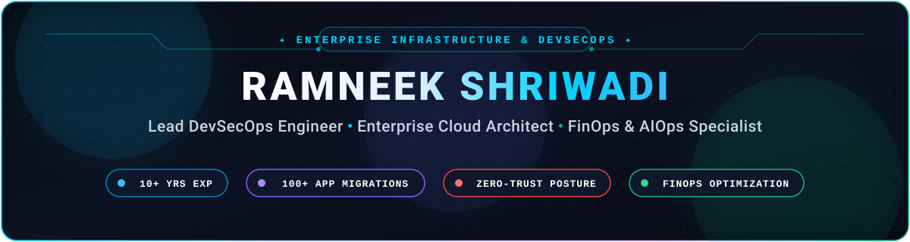

<div align="center">

  <!-- High-Resolution Custom Vector Header Banner -->
  <a href="https://github.com/diaryshriwadi-ops">
    
  </a>

  <br/>

  <!-- Dynamic Typing Subtitle -->
  <a href="https://github.com/diaryshriwadi-ops">
    
  </a>

  <br/><br/>

  <!-- Top Badges / Core Identity -->
  <p align="center">
    
    
    
    
    
  </p>

  <!-- Quick Action & Connect Buttons -->
  <p align="center">
    <a href="mailto:diaryshriwadi@gmail.com">
      
    </a>
    <a href="https://linkedin.com/in/diaryshriwadi-ops">
      
    </a>
    <a href="https://github.com/diaryshriwadi-ops">
      
    </a>
    
  </p>

</div>

---

### 👨‍💻 Executive Summary & Philosophy

> *"True enterprise architecture is not merely about writing tool syntax—it is the strategic convergence of business domain objectives, impenetrable zero-trust security, immutable infrastructure as code, and autonomous self-healing intelligence."*

With **10+ years of battle-tested engineering leadership**, I specialize in transforming monolithic, on-premises enterprise environments into high-velocity, secure, and cost-efficient cloud architectures. Having led complex end-to-end migrations of **100+ enterprise workloads with zero unplanned downtime**, I design multi-tenant **Cloud Adoption Framework (CAF)** landing zones, enforce **shift-left DevSecOps governance**, and implement **next-generation autonomous Agentic AI and RAG observability platforms**.

---

### 🏆 Enterprise Scale & Impact Metrics

<table align="center" width="100%">
  <tr>
    <td align="center" width="25%">
      <h3>🚀 100+ Workloads</h3>
      <p>Zero-downtime datacenter to cloud migrations across Dev, UAT, and Tier-1 Production environments.</p>
    </td>
    <td align="center" width="25%">
      <h3>🛡️ 100% Shift-Left</h3>
      <p>Automated DevSecOps pipelines with SAST, DAST, secret scanning, container signing & policy-as-code.</p>
    </td>
    <td align="center" width="25%">
      <h3>💰 28%+ FinOps ROI</h3>
      <p>Cloud spend optimization via dynamic rightsizing, RI/Savings Plans modeling & DCR log ingestion tuning.</p>
    </td>
    <td align="center" width="25%">
      <h3>🤖 AIOps & RAG Agents</h3>
      <p>Autonomous root-cause triage, vector-based architectural compliance retrieval & self-healing pipelines.</p>
    </td>
  </tr>
</table>

---

### 🏛️ The 10 Architectural Pillars of Enterprise Platforms

Every architecture I design is anchored on 10 non-negotiable scalability and quality pillars:

```
+-------------------------------------------------------------------------------------------------------------+
|                                      THE 10 ENTERPRISE QUALITY PILLARS                                       |
+---------------------+---------------------+---------------------+---------------------+---------------------+
|    1. SCALABLE      |     2. ROBUST       |      3. SECURE      |    4. RELIABLE      |    5. PORTABLE      |
| Horizontal scaling, | Self-healing pods,  | Zero-Trust, PIM,    | 99.99% multi-region | OCI containers,     |
| autoscale VMSS & K8s| chaos-tested nodes  | mTLS & encryption   | SLAs, ASR failover  | multi-cloud ready   |
+---------------------+---------------------+---------------------+---------------------+---------------------+
|    6. GOVERNED      |   7. HIGH AVAIL     |   8. COST-OPTIMIZED |    9. BACKED UP     | 10. OBSERVABLE      |
| Policy as Code,     | Zone-redundant ZRS, | FinOps governance,  | Immutable snapshots,| Real-time AMA logs, |
| guardrails & audit  | active-active mesh  | rightsizing, waste  | RPO < 15m, RTO < 1h | distributed tracing |
+---------------------+---------------------+---------------------+---------------------+---------------------+
```

---

### 🛠️ Enterprise Technology Stack & Skill Matrix

<div align="center">

| Domain | Technologies & Enterprise Tooling |
| :--- | :--- |
| **Cloud Platforms & Architecture** |      |
| **DevSecOps & Supply Chain Security** |         |
| **Infrastructure as Code (IaC)** |       |
| **Containers & Orchestration** | -326CE5?style=flat-square&logo=kubernetes&logoColor=white)     |
| **CI/CD & GitOps Automation** |     |
| **AIOps, RAG & Autonomous Agents** |      |
| **FinOps, Observability & SRE** |       |
| **Programming & Scripting** |       |

</div>

---

### 🧠 Next-Gen Engineering: AIOps, Autonomous Agents & RAG Workflows

Modern DevSecOps is evolving from manual reactive troubleshooting to **autonomous, self-steering, agentic operations**. My engineering practice integrates state-of-the-art AI design patterns directly into enterprise cloud platforms:

```
               [ Enterprise Telemetry & Incident Stream ]
                                   |
                                   v
             +-------------------------------------------+
             |    AUTONOMOUS AIOps & REMEDIATION AGENT   |
             +-------------------------------------------+
               |                  |                    |
      (Semantic Search)    (Tool Calling)      (Policy Boundary)
               |                  |                    |
               v                  v                    v
      [ RAG Knowledge Hub ]  [ Cloud MCP / API ]  [ Zero-Trust Guardrail ]
      - ADRs & Postmortems   - Kubernetes AKS     - PIM Approvals
      - CIS Benchmarks       - Terraform State    - Least-Privilege IAM
      - SOP Runbooks         - Network Flow Logs  - Rollback Circuit Breaker
```

* **🤖 Autonomous Triage & Remediation Agents:** Event-driven agents capable of consuming telemetry alerts, correlating cross-tier logs, invoking diagnostic inspection tools via context protocol standards, and preparing pull-request remediations or automated rollbacks.
* **📚 RAG-Driven Architecture & Policy Retrieval:** Semantic search pipelines over internal Architecture Decision Records (ADRs), regulatory compliance frameworks (CIS, ISO 27001, HIPAA), and disaster recovery playbooks—enabling real-time policy interrogation across large teams.
* **🛡️ LLMOps & GenAI Workload Security Guardrails:** Shift-left security architectures for generative models: prompt sanitization filters, sensitive PII/credential redaction in inference streams, token rate limiting, and zero-egress VPC enclave deployments.
* **⚙️ Agent-Tool Connectivity Protocols:** Decoupled execution interfaces allowing autonomous agents to query Terraform drift status, inspect pod lifecycle health, and trigger self-healing runbooks under strict human-in-the-loop gates.

---

### 🌐 Enterprise Cloud Landing Zone & Hub-and-Spoke Networking

Engineered on **Microsoft Cloud Adoption Framework (CAF)** principles, guaranteeing zero blast radius, centralized security inspection, and segregated management:

```
                            [ Microsoft Entra ID Tenant ]
                                          |
                              [ Tenant Root Group ]
                                          |
         +--------------------------------+--------------------------------+
         |                                |                                |
[ Platform Management Group ]   [ Landing Zones (Workloads) ]    [ Decommissioned / Sandbox ]
   |-- Identity (AD/DNS)           |-- Corp (Internal-Only Spoke)   |-- Sandbox Subscriptions
   |-- Management (Log Analytics)  |-- Online (DMZ / Public Spoke)  `-- Decommissioned Archive
   `-- Connectivity (Hub VNet)     |-- Dev / UAT Subscriptions
                                   `-- Production Subscriptions
```

```
                       [ On-Premises Datacenter ]
                                   |
                    (ExpressRoute / S2S IPsec VPN)
                                   |
+----------------------------------v----------------------------------+
|                   HUB VNet (Central Connectivity)                   |
|                                                                     |
|  +--------------------+   +-------------------+   +--------------+  |
|  | Azure Firewall     |   | GatewaySubnet     |   | Private DNS  |  |
|  | Premium (TLS / IDS)|   | (VPN/ER Gateway)  |   | Zones (Core) |  |
|  +---------+----------+   +-------------------+   +--------------+  |
+------------|--------------------------------------------------------+
             | (VNet Peering + UDR: 0.0.0.0/0 -> Firewall IP)
             +-----------------------+-----------------------+
             |                                               |
+------------v------------+                     +------------v------------+
|  Spoke 1: App Workloads |                     |  Spoke 2: Shared & SRE  |
|  - Web / API Tier NSGs  |                     |  - Self-Hosted Runners  |
|  - Microservices AKS    |                     |  - Bastion Host Enclave |
|  - PaaS Private Endpoints|                    |  - Security & AMA Agent |
+-------------------------+                     +-------------------------+
```

* **Zero-Overlap IPAM:** Strict CIDR allocation mapping on-prem subnets with Azure VNet spaces to eliminate routing collisions.
* **Forced Egress & East-West Inspection:** UDR tables directing all outbound (`0.0.0.0/0`) and spoke-to-spoke traffic through Azure Firewall with SSL termination and IPS/IDS.
* **Private Link Everywhere:** Public internet exposure eliminated for SQL, Storage, and Key Vault using Azure Private Endpoints connected to centralized Hub DNS zones.

---

### 🔒 Enterprise DevSecOps CI/CD & Policy-as-Code Pipeline

From developer commit to multi-region cloud deployment, every artifact passes through automated security quality gates:

```
[ Developer Commit ] 
         |
         v
[ Stage 1: Validation & Linting ] --------> terraform fmt, tflint, syntax check
         |
         v
[ Stage 2: Security & Secret Scan ] ------> GitLeaks, Checkov, Trivy (Zero High/Crit Vulns)
         |
         v
[ Stage 3: FinOps Cost Estimation ] ------> Infracost (Budget baseline & PR diff alerts)
         |
         v
[ Stage 4: Speculative Plan & Drift ] ----> terraform plan -detailed-exitcode
         |
         v
[ Stage 5: Production Approval Gate ] ----> 2 Senior Approvers, Entra PIM JIT Elevation
         |
         v
[ Stage 6: Immutable Terraform Apply ] ---> Blob Lease Lock, Least-Privilege Identity
         |
         v
[ Stage 7: Runtime Observability ] -------> AMA Ingestion, Sentinel SIEM, Automated Rollback
```

* **Immutable State Management:** Terraform state files stored inside zero-public-access Azure Blob Storage with automatic lease locking and customer-managed keys (CMK).
* **Automated Drift Detection:** Nightly scheduled cron pipelines detecting out-of-band console modifications and alerting via webhooks before silent degradation occurs.
* **Branch Protection & Code Owners:** Trunk-based workflow requiring 2+ peer code reviews, enforced `CODEOWNERS` sign-off, and zero unreviewed production merges.

---

### 📦 100+ Enterprise Workload Migration Strategy

A battle-hardened 5-phase migration lifecycle designed for enterprise-scale zero downtime:

```
+---------------+     +---------------+     +---------------+     +---------------+     +---------------+
| 1. DISCOVERY  | --> | 2. ASSESSMENT | --> |  3. READINESS | --> |  4. CUTOVER   | --> | 5. HYPERCARE   |
| Asset audit,  |     | 6-R strategy, |     | Landing Zone, |     | Data sync,    |     | 24x7 War Room,|
| dependencies, |     | TCO / ROI,    |     | ExpressRoute, |     | DNS TTL cut,  |     | telemetry,    |
| latency logs  |     | Wave planning |     | RBAC & PIM    |     | failover test |     | KT handoff    |
+---------------+     +---------------+     +---------------+     +---------------+     +---------------+
```

* **The 6 R's Methodology:** Workloads systematically categorized into *Rehost*, *Replatform*, *Refactor*, *Retain*, *Repurchase*, or *Retire*.
* **Cutover Windows:** Database asynchronous replication converted to synchronous replication at the cutover threshold, with TTL pre-reduced to 60 seconds.
* **Hypercare Governance:** 4-week dedicated war rooms with live synthetic tracing, transaction latency baselining, and immediate stakeholder telemetry reporting.

---

### 💰 FinOps & Cloud Financial Governance

Cost optimization is an architectural foundation, not a post-deployment afterthought:

* **Automated Waste Eradication:** Continuous background scanning identifying unattached managed disks, orphaned snapshots, idle public IPs, and deallocated VMs.
* **Rightsizing Analytics:** Compute rightsizing based on 30-day P95 CPU and memory utilization profiles, avoiding wasteful overprovisioning.
* **Commitment Architecture:** Blending Reserved Instances (1-year and 3-year RI) with Azure Savings Plans for steady-state workloads to capture 40–60% savings.
* **Log Ingestion Throttling:** Azure Monitor Data Collection Rules (DCR) configured to filter verbose debug traces at the source, saving thousands in ingestion costs.
* **Non-Prod Auto-Snoozing:** Event-driven schedule automations shutting down Dev and UAT clusters outside business hours.

---

### 🤝 Engineering Leadership, Governance & Vendor Management

Strategic execution requires senior techno-functional stewardship:

* **Vendor Management & SOWs:** Translating commercial business needs into ironclad Statements of Work (SOW), SLA requirements, and technical deliverable milestones.
* **Technical Evaluation Matrix:** Evaluating third-party software, managed service providers, and vendors against architectural compliance, security audits, and pricing.
* **RACI & Delivery Ownership:** Defining clear **R**esponsible, **A**ccountable, **C**onsulted, and **I**nformed structures across cross-functional engineering teams.
* **Knowledge Transfer & Mentorship:** Conducting architecture review boards (ARBs), hosting technical brown-bags, and upskilling engineers in IaC, DevSecOps, and cloud-native patterns.

---

### 🚀 Featured Architectural Repositories & Reference Blueprints

<table width="100%">
  <tr>
    <td width="50%" valign="top">
      <h4>🏢 <a href="https://github.com/diaryshriwadi-ops">enterprise-azure-caf-landingzone</a></h4>
      <p>Production-ready Terraform implementation of Microsoft Cloud Adoption Framework with Management Groups, Hub-Spoke networking, and CIS compliance guardrails.</p>
      <code>Terraform</code> • <code>Azure CAF</code> • <code>Hub-and-Spoke</code> • <code>Policy</code>
    </td>
    <td width="50%" valign="top">
      <h4>🛡️ <a href="https://github.com/diaryshriwadi-ops">production-devsecops-pipeline</a></h4>
      <p>Zero-trust CI/CD template featuring automated GitLeaks, Checkov, Trivy vulnerability scanning, Infracost budget guardrails, and automated rollback workflows.</p>
      <code>Azure DevOps</code> • <code>GitHub Actions</code> • <code>Trivy</code> • <code>Checkov</code>
    </td>
  </tr>
  <tr>
    <td width="50%" valign="top">
      <h4>🤖 <a href="https://github.com/diaryshriwadi-ops">aiops-rag-remediation-engine</a></h4>
      <p>Autonomous agentic workflow integrating semantic search over enterprise runbooks with tool-calling capabilities to diagnose cluster anomalies and trigger remediation.</p>
      <code>Python</code> • <code>RAG</code> • <code>AIOps</code> • <code>Tool Protocols</code>
    </td>
    <td width="50%" valign="top">
      <h4>💸 <a href="https://github.com/diaryshriwadi-ops">enterprise-finops-cloud-governor</a></h4>
      <p>Automated cloud cost governance suite eliminating orphaned resources, rightsizing compute workloads, and tuning Azure Monitor DCR log ingestion budgets.</p>
      <code>Python</code> • <code>PowerShell</code> • <code>FinOps</code> • <code>Cost Engine</code>
    </td>
  </tr>
</table>

---

### 📊 GitHub Activity & Engineering Analytics

<div align="center">
  <table border="0">
    <tr>
      <td align="center" width="50%">
        
      </td>
      <td align="center" width="50%">
        
      </td>
    </tr>
    <tr>
      <td colspan="2" align="center">
        
      </td>
    </tr>
  </table>
</div>

---

### 📫 Connect & Collaborate

I am always keen to connect with fellow Engineering Leaders, Enterprise Architects, and DevSecOps practitioners who are passionate about building the future of resilient, secure, and intelligent cloud infrastructure.

<div align="center">

  <a href="mailto:diaryshriwadi@gmail.com">
    
  </a>
  &nbsp;&nbsp;
  <a href="https://linkedin.com/in/diaryshriwadi-ops">
    
  </a>
  &nbsp;&nbsp;
  <a href="https://github.com/diaryshriwadi-ops">
    
  </a>

  <br/><br/>
  
  <sub>Crafted with passion, precision, and engineering rigor by <b>Ramneek Shriwadi</b>.</sub>

</div>
